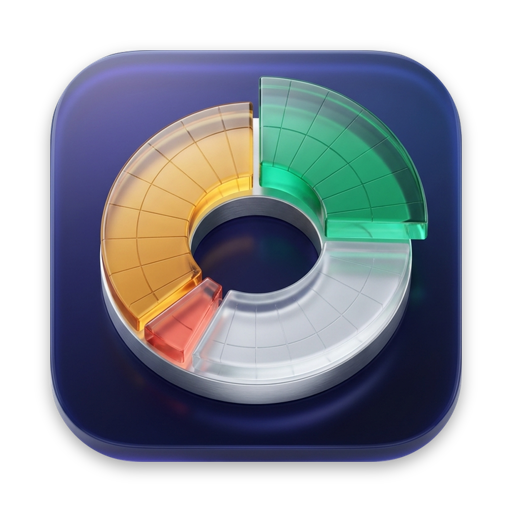
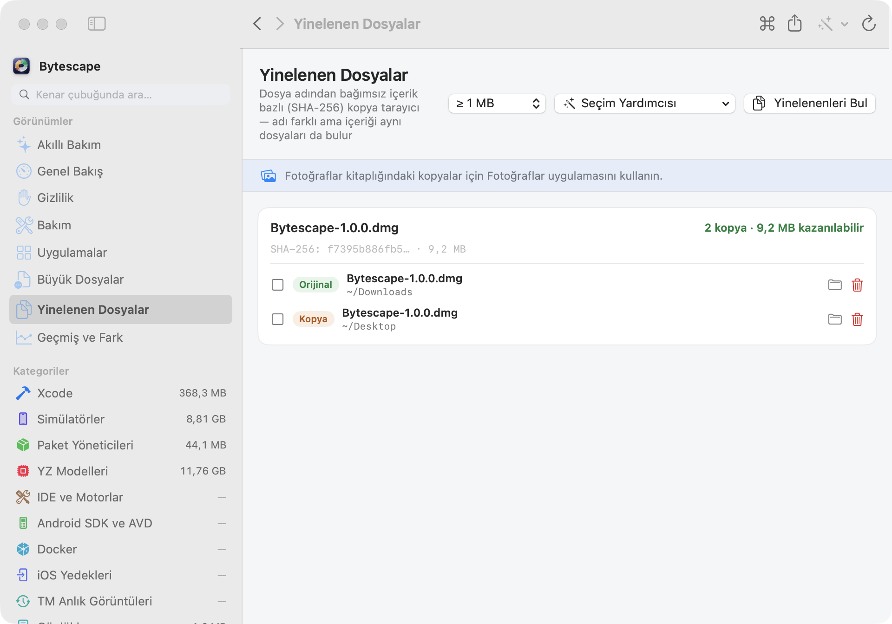

  

<h1 align="center">Bytescape</h1>

  <b>macOS için şeffaf ve güvenli disk alanı yöneticisi</b> 
  "Sistem Verileri"nin içinde ne olduğunu gösterir, yalnızca güvenli olanı temizler.

  
  
  
  

  

## Neden Bytescape?

macOS'ta "Sistem Verileri" onlarca gigabayta ulaşır ama içinde ne olduğu görünmez. Bytescape bu alanı Xcode, simülatörler, Docker, yapay zekâ modelleri, paket yöneticisi önbellekleri, uygulama artıkları gibi anlaşılır kategorilere ayırır; her öğe için **güvenli / incele / manuel** sınıfını, nasıl geri geleceğini ve silmenin etkisini gösterir. Varsayılan olarak her şey **Çöp Kutusu'na** taşınır ve geri alınabilir.

## Öne çıkan özellikler

- **Canlı tarama:** ilerleme halkası, tahmini süre, duraklat/iptal, bulundukça akan sonuçlar; hızlı, tam ve özel tarama.
- **Akıllı Bakım:** tara, önizle ve yalnızca güvenli öğeleri tek adımda temizle.
- **Yinelenen dosyalar:** adları farklı olsa bile içerik (SHA-256) karşılaştırmasıyla bulur; hardlink ve APFS klonlarını kopya saymaz, her grupta bir kopyayı korur.
- **Bilinen uygulama klasörleri:** Claude, Chrome, Slack, VS Code gibi uygulamalarda önbelleği "güvenli", kullanıcı verisini ve sanal makine imajlarını "korunan" olarak ayırır.
- **Uygulama kaldırıcı ve artık temizliği**, başlangıç öğeleri, gizlilik temizliği, bakım komutları.
- **Silmeden önce gerçek kazanç tahmini:** Time Machine anlık görüntüleri ve APFS klonlarını hesaba katar.
- **Çevrimdışı mod, Proje Dondurucu, Disk Karnesi, geçmiş ve fark görünümü.**
- **Menü çubuğu, masaüstü widget'ı, Kısayollar eylemleri ve komut satırı (CLI).**
- **Tamamen yerel:** hiçbir veri cihazdan çıkmaz, telemetri yok. Türkçe ve İngilizce arayüz.

## Kurulum

1. [Releases](../../releases) sayfasından en güncel `Bytescape-x.y.z.dmg` dosyasını indirin.
2. DMG'yi açıp **Bytescape**'i **Applications** klasörüne sürükleyin.
3. İlk açılışta **Sistem Ayarları → Gizlilik ve Güvenlik → Tam Disk Erişimi** bölümünden Bytescape'e izin verin (uygulama sizi doğrudan oraya götürür).

Uygulama Developer ID ile imzalıdır. İlk açılışta macOS bir onay sorabilir; Finder'da Bytescape'e sağ tıklayıp **Aç**'ı seçmeniz yeterlidir.

## Gereksinimler

- macOS 14 Sonoma veya üzeri (Apple Silicon ve Intel)

## English

**Bytescape** is a transparent, safety-first disk space manager for macOS. It breaks down the opaque "System Data" area into clear categories (Xcode, simulators, Docker, AI models, package caches, app leftovers and more), labels every item as *safe*, *review* or *manual*, and moves everything to the Trash by default so it can be undone. It finds duplicate files by content (even with different names), uninstalls apps with their leftovers, estimates the real space you will get back, and runs entirely on your Mac with no telemetry. Download the latest DMG from [Releases](../../releases/latest). Requires macOS 14 or later.

## Geri bildirim

Hata bildirimi ve öneriler için [Issues](../../issues) bölümünü kullanabilirsiniz.

## Lisans

Bytescape tescilli bir yazılımdır; kaynak kodu bu depoda yer almaz. Resmi DMG kişisel kullanım için ücretsiz kurulabilir. Ayrıntılar için [LICENSE](LICENSE).

## Geliştirici

**Enes SAVAŞÇI** · [www.enessavasci.com](https://www.enessavasci.com)

© 2026 Enes SAVAŞÇI. Tüm hakları saklıdır.
